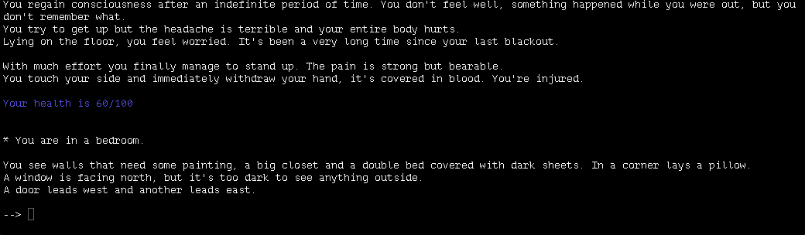

# THE SPIRIT WITHIN US

<p align="center">
  
  
  
  
</p>

<p align="center">
  A text-based psychological thriller and exploration game written in <strong>C</strong>, featuring a simple verb-noun parser, manual, save system, and four possible endings.
</p>


## About the Game

**THE SPIRIT WITHIN US** is a text adventure where you are the main character.  
Your imagination and choices guide the story from beginning to end.

Explore your surroundings carefully, map the geography, and make decisions that can lead to one of four different endings.

> **Please note:** Due to the nature of its contents, this game is **not suitable for children**.


## Features

- Text-based psychological thriller and exploration gameplay.
- Built in **C**.
- Simple but effective **verb-noun parser**.
- Manual/help system included in-game.
- Save and resume functionality.
- Four different endings based on your choices.
- Approximate play time: **1 hour**.


## How To Play

Move through the world by typing directions such as:

```txt
n
e
s
w
```

The game recognizes many commands, including:

```txt
look
look around
examine X
go X
take X
drop X
give X to Y
open X
close X
turn on X
turn off X
attack X
defend
eat X
read X
inventory
help
wait
quit
```

### Parser Tips

1. Use directions to move between places.
2. Commands are mostly in **verb-noun** form.
3. One-word commands like `inventory` give you specific information.
4. Some commands have shortcuts, like `g` for get/take, `l` for look, and `x` for examine.
5. The game understands standard adventure verbs, but there are more to discover as you play.


## Saving Your Game

The game uses a save file so you can stop and continue later.

1. At the beginning, enter a name for your save file.
2. If the file does not exist, it will be created automatically.
3. To resume, enter the same save-file name when launching the game again.
4. To start over, create a new save file.


## Survival Rules

The game follows natural rules.

- You have only **one life**.
- If your energy reaches zero, the player dies and the game ends.


## Download

Executables for **Windows**, **macOS**, and **Linux** are available here:

<p align="center">
  <a href="https://jqrsound.itch.io/the-spirit-within-us" target="_blank">
    
  </a>
</p>


## Docker

**THE SPIRIT WITHIN US** can be built and run in a Docker container with just two commands:

```bash
docker build -t spirit .
docker run --rm -it spirit
```

The `--rm` flag cleans up the container after exit, and `-it` gives the game an interactive terminal so it can read input properly.


## About The Project

During the 2020 lockdown, I began learning C and decided to build a game as a way to put those skills into practice.

This project was inspired by Ruud Helderman’s tutorial **"How to program a text adventure in C"**, then expanded and adapted into a more personal experience.

**THE SPIRIT WITHIN US** is my first C project and first text adventure, created as a complete standalone game.


## Warning

This game contains psychological thriller themes and is intended for mature audiences.


## Screenshots

<p align="center">
  
</p>


<p align="center">
  Made with ❤️ in C
</p>